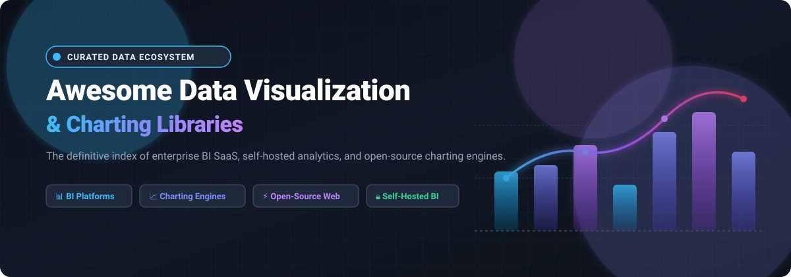

  

  
  
  
  
  

---

# 📊 Awesome Data Visualization &amp; Charting Libraries

Welcome to the definitive curated index of **data visualization libraries**, **interactive charting toolkits**, and **enterprise Business Intelligence (BI) platforms**. Whether you are architecting an interactive analytics dashboard in React/Vue/Svelte, designing publication-quality scientific plots in Python, or evaluating cloud BI suites with governed data semantic layers, this guide covers the modern data landscape.

## 📑 Table of Contents

- [🌐 Sector Overview &amp; Market Dynamics](#-sector-overview--market-dynamics)
- [🏢 SaaS &amp; Hosted BI Platforms](#-saas--hosted-bi-platforms)
- [💻 Open-Source GitHub Projects &amp; Charting Libraries](#-open-source-github-projects--charting-libraries)
- [⭐ Star History](#-star-history)
- [🤝 How to Contribute](#-how-to-contribute)
- [💖 Support &amp; Sponsorship](#-support--sponsorship)
- [⚖️ Disclaimer](#-disclaimer)

---

## 🌐 Sector Overview &amp; Market Dynamics

The global data visualization and business intelligence market is valued at approximately **$11B to $35B** (scaling past **$100B+** across wider cloud analytics by 2030 at ~11% CAGR). The sector exhibits a **hybrid structure—moderately concentrated at the enterprise top** dominated by hyperscalers (Microsoft Power BI, Salesforce Tableau, Google Cloud Looker), yet **heavily fragmented across the application layer and open-source ecosystem**, where specialized charting libraries, embedded analytics engines, and self-hosted tools continuously innovate.

---

## 🏢 SaaS &amp; Hosted BI Platforms

The following table benchmarks top cloud and hosted visual analytics suites. Entries are sorted descending by company size (valuation / annual revenue).

| Platform | Company Valuation / Revenue | Starting Tier Pricing | Free Tier / Trial Limits | Description |
| :--- | :--- | :--- | :--- | :--- |
| **[Microsoft Power BI](https://powerbi.microsoft.com/)** | **~$3.1 Trillion** market cap (Microsoft) | **$10/user/month** (Power BI Pro annual); **$20/user/month** (Premium Per User) | **Free forever plan**: Power BI Desktop (local authoring/modeling only; cloud publishing/sharing disabled). **60-day free trial** for Power BI Pro/Premium. | Deep Office 365 & Azure integration, DAX modeling engine, and ubiquitous enterprise adoption. |
| **[Looker](https://looker.com/)** | **~$2.1 Trillion** market cap (Alphabet/Google) | **$9/user/month** (Looker Studio Pro); enterprise Looker starts at **~$5,000/month** ($60,000/year base platform) | **Free forever plan**: Looker Studio basic (unlimited free report authoring/sharing via Google connectors). **90-day free trial** for Looker Google Cloud core instance. | Cloud BI built around the centralized LookML semantic modeling layer and in-database queries. |
| **[Tableau](https://www.tableau.com/)** | **~$300 Billion** market cap (Salesforce) | **$15/user/month** (Viewer, billed annually); Creator requires **$75/user/month** ($900/year min) | **Free forever plan**: Tableau Public (free authoring, but workbooks must be saved publicly). **14-day free trial** for full Tableau Cloud/Creator. | The industry standard for drag-and-drop visual data exploration and interactive storytelling. |
| **[Sigma Computing](https://www.sigmacomputing.com/)** | **~$3.0 Billion** valuation (Series D) | **$300/month** (base entry tier); median mid-market deployments start at **~$15,000–$30,000/year** | **7-day free trial**: Access to full spreadsheet interface on sample data or connected warehouse (capped at 50 total exports). | Cloud-native analytics platform combining a spreadsheet-like UI with direct, live SQL queries on Snowflake, BigQuery, and Databricks. |
| **[Domo](https://www.domo.com/)** | **~$350 Million** market cap (Public: DOMO) | **$2,500/month** ($30,000/year committed tier with ~9,200 consumption credits) | **30-day free trial**: Enterprise platform access with no credit limits (excludes AutoML and Jupyter workspaces). | Full-stack cloud analytics suite offering drag-and-drop Magic ETL, 1,000+ connectors, and unlimited seats. |

---

## 💻 Open-Source GitHub Projects &amp; Charting Libraries

A comprehensive selection of open-source charting toolkits, graphics grammars, and self-hosted BI platforms. Sorted descending by GitHub star count.

| Project | Stars | License | Rendering Tech | Primary Focus &amp; Best Used For |
| :--- | :--- | :--- | :--- | :--- |
| **[D3.js](https://github.com/d3/d3)** |  | ISC | SVG, Canvas, HTML | Foundational low-level visualization grammar. Binds data directly to the DOM for complete design freedom and custom animations. |
| **[Mermaid](https://github.com/mermaid-js/mermaid)** |  | MIT | SVG | Markdown-inspired text-to-diagrams and visualization tool. Ideal for flowcharts, sequence diagrams, Gantt charts, and state graphs. |
| **[Apache Superset](https://github.com/apache/superset)** |  | Apache-2.0 | React, D3, DeckGL | Enterprise-ready self-hosted BI platform. Includes no-code chart builders, SQL IDE, free embedded dashboards, and row-level security (RLS). |
| **[Chart.js](https://github.com/chartjs/Chart.js)** |  | MIT | HTML5 Canvas | Lightweight, responsive web charting library. Best for quick, accessible, and animated bar, line, and radar charts out of the box. |
| **[Apache ECharts](https://github.com/apache/echarts)** |  | Apache-2.0 | Canvas, SVG (ZRender) | High-performance declarative charting library. Exceptional for dynamic sorting bar charts, geospatial heatmaps, 3D globes, and large datasets. |
| **[Metabase](https://github.com/metabase/metabase)** |  | AGPL-3.0 | Web Application (Clojure/React) | The most user-friendly self-hosted BI platform. Allows non-technical business users to build dashboards and ask questions without writing SQL. |
| **[Recharts](https://github.com/recharts/recharts)** |  | MIT | React, SVG | Redefined charting library built on React components and D3 submodules. Offers a clean, declarative JSX API for React web apps. |
| **[Plotly Dash](https://github.com/plotly/dash)** |  | MIT | React, Plotly.js | Python/R/Julia framework for building interactive analytical web applications and production data science dashboards without JavaScript. |
| **[Plotly.js](https://github.com/plotly/plotly.js)** |  | MIT | D3.js, WebGL, SVG | Declarative scientific graphing library powering Plotly Python and Dash. Supports 40+ statistical, financial, geographic, and 3D chart types. |
| **[ApexCharts.js](https://github.com/apexcharts/apexcharts.js)** |  | MIT | SVG | Modern JavaScript charting library with polished UI themes, smooth zooming/panning, and official integrations for Vue, React, and Angular. |
| **[AntV G2](https://github.com/antvis/G2)** |  | Apache-2.0 | Canvas, SVG | A data-driven visualization grammar designed by Ant Group. Highly composable and structured according to Wilkinson's Grammar of Graphics. |
| **[Panel](https://github.com/holoviz/panel)** |  | BSD-3-Clause | Python, Bokeh | Python toolkit for creating exploratory data apps and multi-page dashboards with Bokeh, Matplotlib, Plotly, and Altair integrations. |
| **[Vega-Lite](https://github.com/vega/vega-lite)** |  | BSD-3-Clause | Canvas, SVG | High-level declarative grammar of interactive graphics. Compiles concise JSON specifications into full Vega visualization descriptions. |
| **[Observable Plot](https://github.com/observablehq/plot)** |  | ISC | SVG | Concise exploratory visualization engine created by the authors of D3. Features built-in statistical transforms and composable marks. |

---

## ⭐ Star History

---

## 🤝 How to Contribute

Contributions are warmly encouraged! Help keep this ecosystem up to date:

1. 🍴 **Fork the repository**.
2. 🌿 **Create a new branch**: `git checkout -b feature/add-new-library`.
3. 📝 **Add or update an entry** in `README.md` maintaining alphabetical or star-ranked order. Ensure factual descriptions, verified starting prices, and official links.
4. 🚀 **Commit your changes**: `git commit -m 'feat: add <ToolName> to charting ecosystem'`.
5. 📬 **Open a Pull Request** with a brief summary of why the library or platform should be featured.

---

## 💖 Support &amp; Sponsorship

Thank you for visiting and using this resource! If you find this curated collection valuable for your projects, research, or team, please consider supporting the maintenance of this repository:

- ⭐ **Star this repository** to help others discover it on GitHub.
- 🍴 **Fork and share** with colleagues and the broader data community.
- ☕ **Buy me a coffee / Sponsor**: Support ongoing maintenance on the [GitHub Sponsor Dashboard](https://github.com/sponsors/ishandutta2007).

---

## ⚖️ Disclaimer

- This repository is a **community-curated index** provided for informational and educational purposes. Mention of specific platforms or tools does not constitute an endorsement.
- Pricing, free tier quotas, and feature sets change frequently. Always confirm terms with the respective vendor documentation.
- When evaluating data visualization platforms, ensure appropriate data governance, row-level security (RLS), and compliance protocols are configured before exposing sensitive databases.

---

  <b>Built with ❤️ for data analysts, visual engineers, and business intelligence architects.</b>

